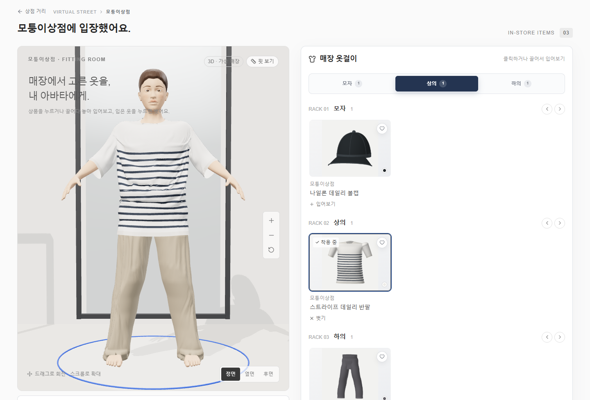
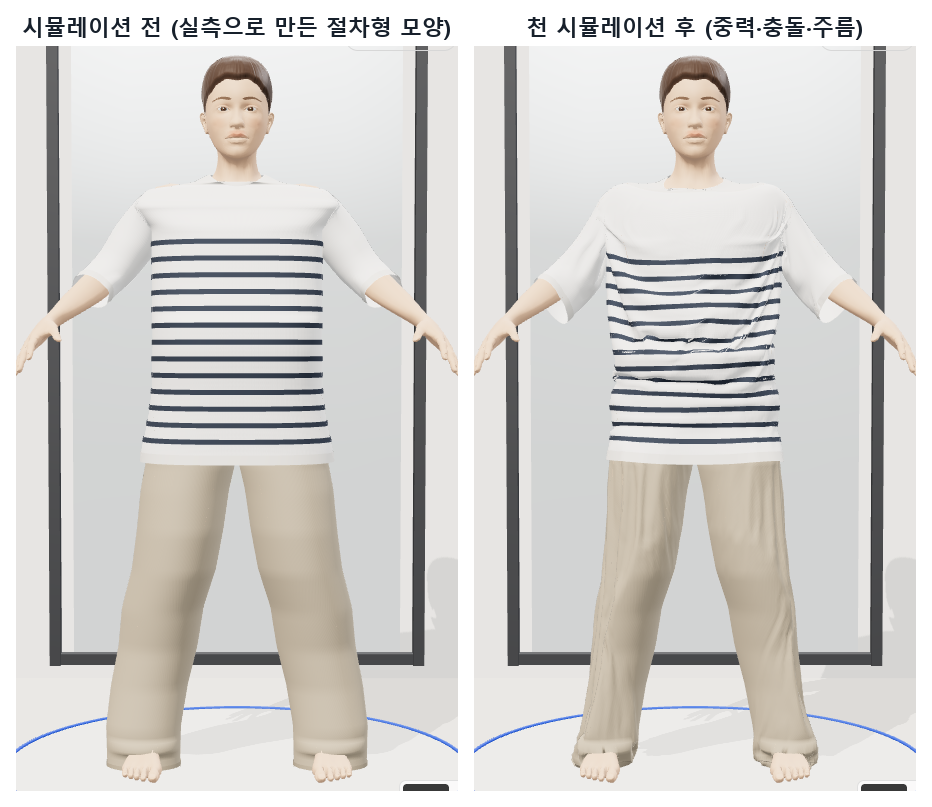
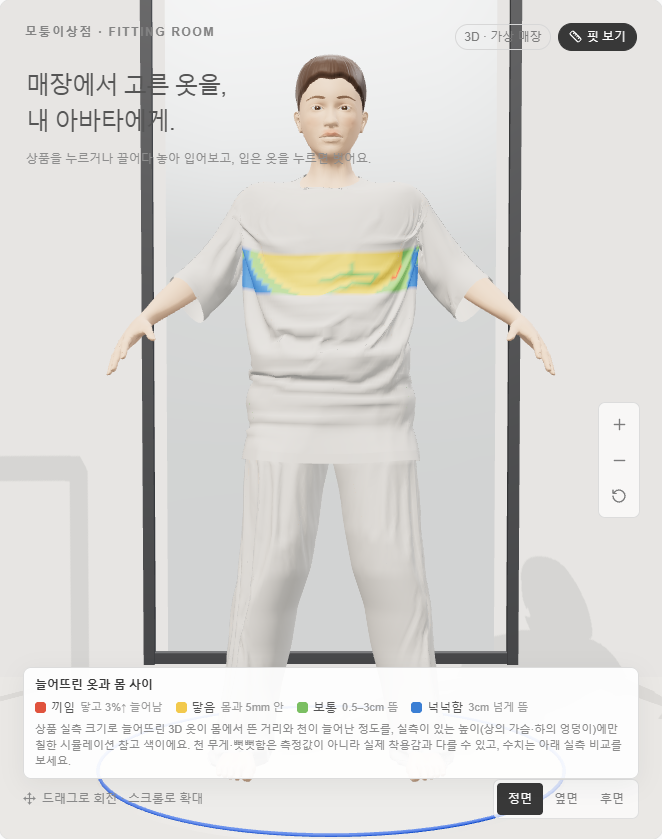
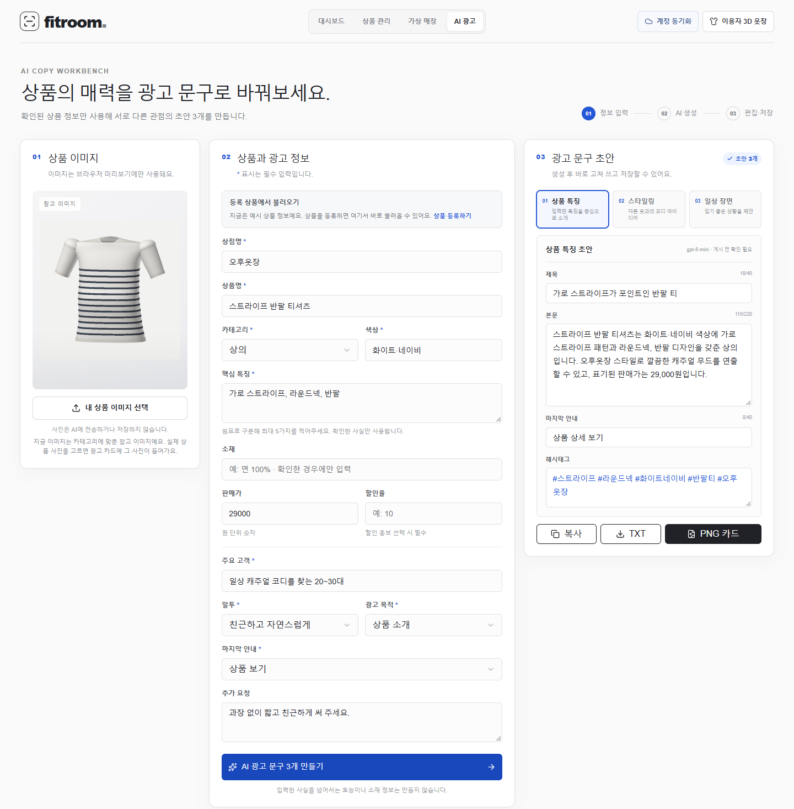
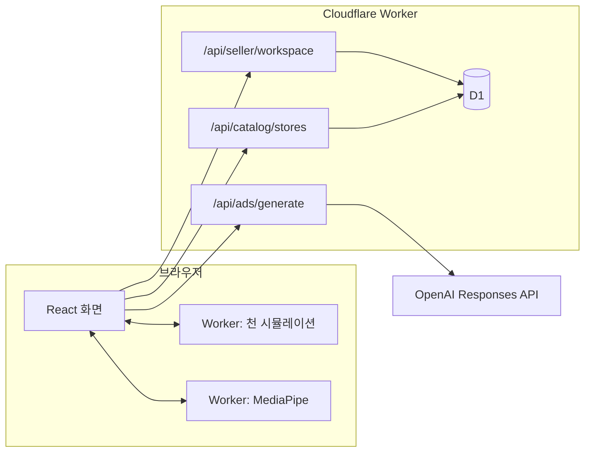

# FITROOM — 의류 소상공인을 위한 3D 피팅룸과 AI 광고 스튜디오

작은 옷가게 판매자는 상품을 등록하고 **AI로 SNS 광고 문구**를 만들고, 손님은 가상 상점 거리에서 **내 체형의 3D 아바타에 옷을 입혀 보는** 웹 서비스입니다.

교육 과정의 개인 과제로 진행했습니다(2026.09.16 – 10.03). 과제 요구사항은 "생성형 AI로 소상공인의 광고 콘텐츠 만들기"였고, 그 전에 만들어 둔 3D 옷장을 판매자·손님 두 공간을 잇는 서비스로 확장했습니다.



## 무엇을 하나요

| 판매자 | 손님 |
|---|---|
| 상품, 가격, 재고, 사이즈 실측 등록 | 가상 상점 거리에서 매장을 골라 입장 |
| 가상 매장 꾸미기와 진열 위치 지정 후 게시 | 옷걸이의 상품을 내 체형 아바타에 입혀 보기 |
| **AI 광고 스튜디오**: 상품 정보로 인스타그램 광고 초안 3개 생성 → 편집 → 복사·TXT·PNG 카드 저장 | **핏 보기**: 옷이 몸 어디에서 끼고 뜨는지 색으로 확인 |
| 계정 동기화 (ChatGPT 로그인, 서버 DB) | 정면·측면 사진으로 체형 추정 (사진은 기기 밖으로 나가지 않음) |

## 핵심 기술

자세한 동작 원리는 **[ARCHITECTURE.md](docs/ARCHITECTURE.md)**에 코드 위치와 함께 정리했습니다.

### 1. 천 처짐 시뮬레이션

판매자 실측으로 만든 옷을 **XPBD 천 시뮬레이션**으로 몸 위에 늘어뜨립니다. 입자 약 1만 개에 늘어남, 굽힘, 바느질, 허리 고정 제약을 걸고, 몸과 먼저 입은 바지를 **부호 있는 거리장(SDF)**으로 만들어 충돌시킵니다. 계산은 Web Worker에서 돌아서 화면이 멈추지 않고, 옷이 내려앉는 중간 모습도 보여줍니다.



### 2. 실측 기반 핏 지도

옷을 **상품 실측 크기 그대로** 늘어뜨려서, 몸보다 작은 옷은 실제로 늘어나 당깁니다. 늘어뜨린 뒤 입자마다 몸과의 틈과 둘레 방향 늘어남을 재서 끼임(빨강), 닿음(노랑), 보통(초록), 넉넉함(파랑)으로 칠합니다.

체형이 바뀌어도 옷이 몸을 뚫지 않게, 마네킹을 2cm 간격으로 잘라 만든 **단면 표**에 체형 모프 7종의 변화량을 기록해 두고 씁니다.



### 3. AI 광고 문구 생성과 평가

`gpt-5-mini` Responses API를 **Structured Outputs**(JSON Schema strict)로 호출하고, 결과를 Zod로 한 번 더 검증합니다. 프롬프트에는 프롬프트 주입 방어, 입력에 없는 사실 금지, 세 가지 관점, 말투·목적별 기준, AI 문투를 피하는 문체 규칙을 넣었습니다.

같은 입력으로 실제 모델을 반복 실행해 **자동 검사 → 프롬프트 수정 → 재생성**을 다섯 번 돌았습니다.
- 형식 문제(요청 문장 인용, 신상·할인 표현 누락, 반복 문장)는 개정 뒤 거의 사라졌습니다.
- 규칙을 늘리자 평가어와 AI 문투가 오히려 늘어서(`.2`판 24개), 문체 규칙을 따로 넣어 최종 6개로 줄였습니다. 다만 첫 판(1개)보다는 많습니다.
- "소재 정보는 제공되지 않았습니다" 같은 문장은 프롬프트로 막아도 남다가, 빈 항목을 요청에서 아예 빼자 0건이 됐습니다.
- 최종 판 사람 평가는 3.5/5입니다 (평가자 1명, 초안 12개).



> 이 화면의 초안은 2026-09-30 평가 실행에서 기록된 실제 `gpt-5-mini` 출력([기록](docs/evaluations/runs/repeats/2026-09-30.5-0.json)의 `normal-top`)입니다. 로컬에는 API 키가 없어서, 같은 입력을 보냈을 때 기록된 응답을 돌려주는 방식으로 화면을 재현했습니다.

### 4. 사진으로 체형 추정

MediaPipe Pose Landmarker를 브라우저 Worker에서 돌려 관절과 사람 영역을 찾습니다. 입력한 키로 배율을 맞추고, 정면 폭과 측면 깊이를 타원으로 보고 가슴·허리·엉덩이 둘레를 추정합니다. 사진은 서버로 보내지 않습니다.

## 숫자로 보기

| 항목 | 값 |
|---|---|
| 자동 테스트 | 156개 (GitHub Actions: 설치 → 테스트 → 타입 검사 → 빌드) |
| 천 시뮬레이션 | 상의 입자 약 1만 개, 한 벌 약 1초 (개발 당시 노트북) |
| 천 시뮬레이션 검사 | 몸 안으로 들어간 정점 0.5% 미만, 어깨·몸통 노출 3%·2% 이하를 실제 마네킹으로 검사 |
| 광고 프롬프트 | 6개 판, 실제 모델 호출 56회 |
| 광고 응답 시간 | 평균 19.1초 → 7.2초 (추론 강도 `low` 포함) |

## 구조



| 영역 | 기술 |
|---|---|
| 화면 | React 19, TypeScript, Vinext(Vite), Tailwind CSS |
| 3D | Three.js, MakeHuman CC0 마네킹, XPBD 천 시뮬레이션(직접 구현), SDF 충돌 |
| AI | OpenAI `gpt-5-mini` Responses API + Structured Outputs, MediaPipe Pose Landmarker |
| 검증 | Zod (입력·출력·저장 데이터), Node.js 테스트 러너 |
| 서버 | Cloudflare Workers, D1(SQLite) + Drizzle ORM, ChatGPT 로그인 |

## 개인정보와 보안

- 체형 사진과 상품 사진은 브라우저 안에서만 씁니다. 서버와 OpenAI에는 텍스트로 된 상품 정보만 보냅니다.
- 공개 카탈로그 API는 게시 검증을 다시 거친 매장·상품만 내보내고, 계정 ID와 초안은 뺍니다.
- OpenAI API 키는 서버 환경 변수로만 읽습니다. 키가 없으면 예시 문구를 AI 결과처럼 보여주지 않고 "연결 설정 필요"를 표시합니다.

## 실행

Node.js 22.13 이상이 필요합니다.

```bash
npm ci
npm run dev        # http://localhost:5173
```

```bash
npm test
npm run typecheck
npm run build
```

- AI 광고 생성에는 서버 환경 변수 `OPENAI_API_KEY`가 필요합니다. 없어도 나머지 기능은 모두 동작합니다.
- 판매자 계정 동기화를 로컬에서 확인하는 방법(D1 마이그레이션)은 [기능 상세](docs/FEATURES.md#실행)에 있습니다.
- 광고 평가: `npm run evaluate:ads -- --dry-run` (키 없이 입력 규격만 검사)

## 한계

- 천 물성(무게, 뻣뻣함)은 면 원단에 가깝게 고른 값이고 측정하지 않았습니다. 천끼리 충돌은 계산하지 않습니다.
- 체형 사진 추정과 핏 표시는 실제 신체 치수나 착용 결과로 검증하지 않은 참고 정보입니다.
- 광고 문구 평가는 입력 4건, 사람 평가자 1명 규모입니다. 최종 판에도 소재를 이유로 효과를 붙인 문장이 2/12건 남았습니다.
- 휴대폰 성능은 측정하지 않았습니다. 공개 배포 데모는 아직 없습니다.

## 문서

| 문서 | 내용 |
|---|---|
| [ARCHITECTURE.md](docs/ARCHITECTURE.md) | 핵심 기술의 동작 원리와 코드 위치 |
| [FEATURES.md](docs/FEATURES.md) | 기능별 상세 동작, 저장 규칙, 정확도 한계 |
| [PROJECT_PLAN.md](docs/PROJECT_PLAN.md) | 기획서와 첫 버전 범위 |
| [평가 안내](docs/evaluations/README.md) | 광고 문구 실제 모델 평가와 프롬프트 개정 기록 |
| [VALIDATION.md](docs/VALIDATION.md) | 검증 항목과 결과 |
| [TOOLS_AND_AI.md](docs/TOOLS_AND_AI.md) | 사용한 도구, AI 모델, 개발 보조 AI의 사용 범위 |
| [업무 일지](docs/journal/) | 날짜별 작업과 판단 |
| [보고서 PDF](output/pdf/FITROOM_PROJECT_REPORT.pdf) | 과제 제출 보고서 |

## 개발 방식

AI 코딩 도구와 함께 만들었습니다. 2026-09-15~09-29 오전에는 Codex를, 09-29 오후부터는 Claude Code를 썼고, 도구별 사용 범위는 [TOOLS_AND_AI.md](docs/TOOLS_AND_AI.md)에 적어 두었습니다.

스크린샷은 로컬 개발 서버에서 헤드리스 Chromium으로 찍었습니다. 천 시뮬레이션 전후 비교의 "전" 사진은 시뮬레이션 Worker만 응답하지 않게 바꿔 절차형 모양을 남긴 것이고, 비교 사진에서만 화면 안내 문구를 가렸습니다.
