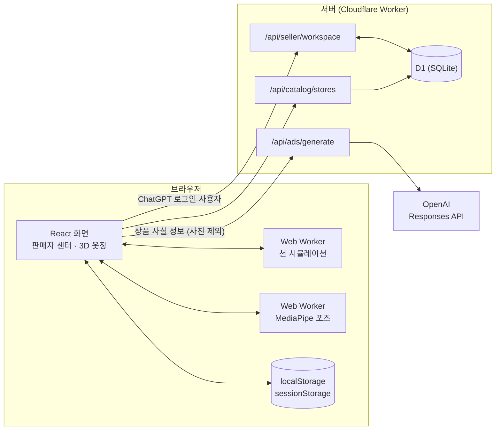
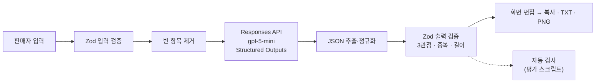

# FITROOM 핵심 기술 설명

FITROOM에서 기술적으로 가장 무거운 네 부분이 어떻게 동작하는지, 코드 위치와 함께 설명합니다.

1. 실측으로 3D 옷 만들기 (체형 단면 표)
2. 천 처짐 시뮬레이션 (XPBD + 부호 있는 거리장)
3. 사진으로 체형 추정 (MediaPipe)
4. AI 광고 문구 파이프라인 (Structured Outputs + 검증 + 평가)

마지막에는 데이터 저장과 보안, 테스트, 알려진 한계를 정리했습니다.

## 전체 구조

- 무거운 계산(천 시뮬레이션, 포즈 인식)은 Web Worker에서 돌려 화면이 멈추지 않게 했습니다.
- 사진(체형 사진, 상품 사진)은 브라우저 밖으로 나가지 않습니다. 서버와 OpenAI에는 텍스트로 된 사실 정보만 보냅니다.

---

## 1. 실측으로 3D 옷 만들기

**문제** — 판매자가 입력하는 건 "가슴단면 52cm, 총장 70cm" 같은 숫자뿐입니다. 이 숫자로 옷 모양을 만들고, 체형이 바뀌어도 몸이 옷을 뚫고 나오지 않게 해야 합니다.

**마네킹 단면 표** — [`scripts/measure-mannequin.ts`](../scripts/measure-mannequin.ts)가 175cm 마네킹(MakeHuman CC0, `public/models/mannequin.glb`)을 바닥부터 **2cm 간격으로 수평으로 잘라** 높이마다 몸통·다리·팔 단면의 둘레, 반폭, 반깊이, 중심을 잽니다. 체형 모프 7종(가슴, 허리, 엉덩이, 어깨, 팔 길이, 다리 길이, 머리)을 하나씩 +1·−1로 줬을 때 단면이 얼마나 바뀌는지도 함께 기록해서 [`lib/wardrobe/mannequin-sections.ts`](../lib/wardrobe/mannequin-sections.ts)라는 표로 만듭니다.

**체형별 단면 계산** — [`lib/wardrobe/body-shape.ts`](../lib/wardrobe/body-shape.ts)는 사용자 치수를 모프 가중치로 바꿉니다. 키 175cm 기준으로 정규화한 뒤 `(치수 − 중립값) / 가중치 1당 변화량`을 −1~1로 자릅니다. 그다음 표의 변화량을 가중치만큼 더해 **현재 체형의 몸 단면**을 계산합니다. 모프는 정점을 선형으로 옮기므로 단면도 거의 선형으로 변한다는 점을 이용한 것입니다.

**옷 형태** — [`lib/wardrobe/geometry.ts`](../lib/wardrobe/geometry.ts)의 `makeGarment`가 높이마다 고리(ring)를 쌓아 옷을 만듭니다. 둘레는 상품 실측을 따릅니다. 몸 단면이 옷보다 큰 높이에서만 고리를 몸 바깥으로 넓혀서 몸이 뚫고 나오지 않게 합니다. 넓힌 비율(`restScale`)은 기록해 두었다가 천 시뮬레이션에서 다시 실측 크기로 당길 때 씁니다.

**판매자 사진 실루엣** — [`lib/seller/photo-silhouette.ts`](../lib/seller/photo-silhouette.ts)는 평면으로 찍은 상의·바지 사진의 윤곽에서 겨드랑이 높이, 높이별 폭 비율, 다리 테이퍼 같은 **비율 숫자만** 뽑아 상품 정보에 저장합니다. 사진 자체는 저장하지 않습니다.

## 2. 천 처짐 시뮬레이션

**문제** — 절차형으로 만든 옷은 마네킹 위에 뻣뻣하게 떠 있습니다. 실제 옷처럼 어깨에 걸치고, 남는 천이 처지고, 상의 밑단이 바지 위로 내려오게 만들고 싶었습니다.

### 2.1 XPBD 시뮬레이션 — [`lib/wardrobe/cloth.ts`](../lib/wardrobe/cloth.ts)

옷 메시의 정점을 **입자**(상의 기준 약 1만 개)로 보고, 입자 사이에 **제약**을 걸어 위치를 직접 고치는 방식입니다(XPBD, Macklin et al. 2019 "Small Steps"). 힘을 적분하는 대신 "이 두 점은 이 거리를 유지해야 한다"를 반복해서 맞춥니다.

| 제약 | 역할 |
|---|---|
| 늘어남 (삼각형 모서리) | 모서리 길이를 쉬는 길이로 유지. 천이 고무처럼 늘어나지 않게 함 |
| 굽힘 (마주 보는 꼭짓점 사이) | 약하게 유지. 값이 작을수록 잘 접혀서 주름이 생김 (바지는 저지보다 3배 뻣뻣하게) |
| 바느질 (소매 ↔ 몸판) | 소매 첫 고리를 가장 가까운 몸판 입자 두 개에 연결 |
| 끈 (long range attachment) | 바지 허리를 고정하고, 각 입자가 허리에서 처음 거리보다 멀어지지 못하게 함. 밑위가 펴지며 가랑이가 처지는 것을 막음 (Kim et al. 2012) |
| 충돌 + 마찰 | 몸 거리장보다 안쪽이면 바깥으로 밀어내고, 미끄러진 만큼 마찰로 줄임. 바닥도 같은 방식 |

한 번의 시뮬레이션은 0.6초 분량을 **초당 600단계**(360단계)로 나눠 돕니다. 단계마다 다음을 반복합니다.

1. 중력과 감쇠를 적용해 위치를 예측합니다.
2. 늘어남·바느질 제약을 3회 풉니다.
3. 끈 제약을 적용합니다.
4. 굽힘 제약을 2단계에 한 번 풉니다.
5. 충돌과 마찰을 처리합니다.
6. 위치 변화로 속도를 다시 계산합니다. 튀는 입자는 속도 상한(1.5m/s)으로 자릅니다.

**어깨 맞춤** — 절차형 상의는 어깨선이 몸보다 완만해서 그대로 떨어뜨리면 목 둘레가 구겨집니다. 시뮬레이션 처음 40% 동안만 어깨 위쪽 모서리의 쉬는 길이를 눌린 만큼 줄여서(처음 길이의 70%까지) 패턴의 어깨 기울기를 흉내 냅니다.

**실측 크기로 당기기** — 1절에서 몸보다 작아 넓혀 그린 고리는 **둘레 방향 쉬는 길이를 실측 크기로 되돌립니다**. 그래서 작은 옷은 몸 위에서 실제로 늘어나 당기고, 이 늘어남이 핏 지도에 나타납니다.

**덧붙은 조각** — 밑단, 카라, 단추, 주머니, 사진 앞면 텍스처는 시뮬레이션하지 않습니다. 처음 모양에서 가장 가까운 천 삼각형의 무게중심 좌표와 법선 거리로 묶어 두고 천을 따라 옮깁니다.

### 2.2 충돌체: 부호 있는 거리장 — [`lib/wardrobe/body-sdf.ts`](../lib/wardrobe/body-sdf.ts)

몸과 이미 입은 바지를 **8mm 격자의 거리장(SDF)**으로 바꿔 둡니다. 격자점마다 표면까지의 거리를 저장하고, 몸 안이면 음수, 밖이면 양수입니다. 입자마다 삼선형 보간으로 거리와 기울기(밀어낼 방향)를 바로 읽을 수 있어서 메시와 직접 충돌 판정하는 것보다 훨씬 빠릅니다.

만드는 순서는 이렇습니다.

1. **안팎 판정:** 높이마다 메시를 수평으로 잘라 단면을 만들고, 줄마다 교차점을 정렬해 홀짝 규칙으로 안쪽을 칠합니다.
2. **표면 근처:** 각 삼각형 주변 2칸 안의 격자점은 점–삼각형 최단 거리를 정확히 계산합니다(Ericson, *Real-Time Collision Detection* 5.1.5).
3. **그 바깥:** 이웃 26칸을 따라 앞뒤로 두 번 쓸어서 거리를 퍼뜨립니다(챔퍼 거리).
4. **합치기:** 여러 메시(몸, 바지, 허리밴드, 벨트 고리)는 메시마다 따로 만든 뒤 칸마다 최솟값을 남겨 합칩니다. 한 번에 모든 삼각형까지 재면, 바지 안에 묻힌 몸 표면이 가장 가까운 표면으로 잡혀 천을 안쪽으로 미는 문제가 생기기 때문입니다.

**속도를 위한 처리** — 몸에서 멀리 떨어진 입자는 한 단계에 움직일 수 있는 거리로는 닿을 수 없는 동안(최대 6단계) 거리장을 다시 읽지 않습니다. 작은 메시(벨트 고리)는 자기 주변 작은 격자에서만 계산합니다.

### 2.3 실행 순서 — [`lib/wardrobe/drape-worker.ts`](../lib/wardrobe/drape-worker.ts), [`drape.ts`](../lib/wardrobe/drape.ts)

1. 화면은 먼저 절차형 옷을 바로 보여줍니다.
2. Web Worker가 **바지를 먼저** 몸 위에 늘어뜨려 캐시해 둡니다(최대 8벌).
3. 상의는 몸과 늘어뜨린 바지(천 두께만큼 6mm 부풀림)를 합친 거리장 위에 늘어뜨립니다.
4. 30단계마다 중간 모양을 화면으로 보내 옷이 내려앉는 모습을 보여주고, 끝나면 최종 모양으로 바꿔 끼웁니다.

개발 당시 노트북 기준으로 상의 한 벌은 약 1~1.2초, 바지 한 벌은 약 1.1초가 걸렸습니다.

### 2.4 핏 지도

- **숫자 핏**([`lib/wardrobe/fit.ts`](../lib/wardrobe/fit.ts)) — `옷 둘레 − 몸 둘레`를 cm로 보여줍니다. 밴딩 허리나 조절형 모자처럼 비교 근거가 없는 항목은 0으로 채우지 않고 "판단 보류"로 둡니다.
- **시뮬레이션 핏 지도** — 늘어뜨린 뒤 실측이 있는 높이의 입자마다 **몸까지의 틈**과 **둘레 방향으로 늘어난 비율**을 계산해 칠합니다.

| 색 | 기준 |
|---|---|
| 빨강 (끼임) | 몸에 닿고 3% 넘게 늘어남 |
| 노랑 (닿음) | 몸에서 5mm 안 |
| 초록 (보통) | 0.5~3cm 떠 있음 |
| 파랑 (넉넉함) | 3cm보다 더 뜸 |

### 2.5 아바타 모습 — [`lib/wardrobe/hair.ts`](../lib/wardrobe/hair.ts), [`appearance.ts`](../lib/wardrobe/appearance.ts)

체형 편집의 "아바타 모습"에서 피부색 5종, 머리 모양(짧은 머리·단발·없음), 머리색 3종을 고릅니다. 이 브라우저에만 저장하고 핏 계산·천 시뮬레이션에는 쓰지 않습니다. 몸 형태와 A 포즈는 그대로라 단면 표와 시뮬레이션 결과도 그대로입니다.

- **얼굴** — 마네킹 GLB에 눈(흰자·홍채·동공), 눈썹 띠, 입술·볼·눈두덩 정점 색을 더했습니다([자산 설명](assets/MAKEHUMAN.md)). 피부 재질은 고른 피부색에 이 정점 색을 곱하고, 광택 대신 약한 솜털 광택(sheen)을 줍니다.
- **머리카락** — 지금 체형으로 모프한 머리를 3mm 간격으로 수평으로 자르고, 방향 96개마다 머리 반지름을 잽니다. 그 위에 두께를 준 껍질을 만들고, 머리카락이 끝나는 높이는 스타일별 방향 표(앞 0° ~ 뒤 180°)로 정합니다. 짧은 머리는 귀 앞 구레나룻을 지나 귀 위로 둘러 깎은 선, 단발은 턱선까지입니다.
  - 귀처럼 좁게 튀어나온 곳은 이웃 방향·높이의 최댓값으로 넓힌 뒤 다듬어 머리카락이 뚫리지 않게 넘어갑니다.
  - 단발은 귀 위 두개골 높이 아래로 그 반지름보다 안쪽으로 들어가지 않고, 귀를 넘은 뒤 천천히 안으로 떨어지며, 끝을 살짝 안으로 맙니다.
  - 끝 18%는 두께를 줄여 머리선이 피부에 닿습니다. 모자를 쓰면 모자 띠 아래로만 만듭니다.
- **원단 결** — 니트·평직·능직·데님을 상품 이름과 스타일로 고르고, 절차형 노멀맵(128px, 반복)으로 표면 음영만 바꿉니다. 색과 형태는 그대로입니다.
- **조명** — 부드러운 그림자(PCF soft), 따뜻한 주광, 뒤쪽 테두리광으로 머리와 어깨 윤곽을 살립니다.

## 3. 사진으로 체형 추정 — [`lib/wardrobe/photo-estimate.ts`](../lib/wardrobe/photo-estimate.ts)

1. Web Worker([`photo-worker.ts`](../lib/wardrobe/photo-worker.ts))에서 MediaPipe Pose Landmarker Lite로 정면·측면 사진의 **관절 33개와 사람 영역 마스크**를 얻습니다. 모델과 WASM 파일은 같은 사이트에서 제공해서 사진이 외부로 나가지 않습니다.
2. 사진을 검증합니다. 한 사람만 있는지, 주요 관절이 보이는지, 전신이 잘리지 않았는지, 정면은 어깨가 충분히 벌어졌는지, 측면은 90도 돌았는지 확인합니다.
3. 입력한 키와 마스크 높이로 **픽셀 → cm 배율**을 정합니다.
4. 어깨와 엉덩이 관절 사이의 정해진 비율 높이(가슴 25%, 허리 69%, 엉덩이 100%)에서 마스크 폭을 잽니다. 정면 폭과 측면 깊이를 **타원의 두 지름**으로 보고 라마누잔 근사로 둘레를 구합니다.
5. 사용자가 직접 입력한 치수는 덮어쓰지 않습니다. 결과는 사용자가 확인한 뒤에만 적용합니다.

관절은 재봉 측정 지점과 다르고 자세, 원근, 옷 두께의 영향을 받습니다. 실제 신체 치수로 정확도를 검증하지 않았습니다.

## 4. AI 광고 문구 파이프라인

**호출** — [`lib/ads/openai.ts`](../lib/ads/openai.ts)
- `text.format`에 `json_schema`(strict)를 지정해서 모델이 제목, 본문, CTA, 해시태그 구조를 반드시 지키게 합니다.
- 받은 JSON은 Zod로 한 번 더 검사합니다. 세 관점이 하나씩 있는지, 제목이 겹치지 않는지, 길이와 해시태그 개수가 맞는지 확인합니다.
- `store: false`로 요청을 OpenAI에 저장하지 않습니다. 추론 강도는 `low`, 제한 시간은 45초입니다.
- 실패는 401·403(키 문제), 429(요청 몰림), 5xx(서비스 장애), 형식 오류, 시간 초과로 나눠 사용자 안내 문구와 HTTP 상태로 바꿉니다.
- 판매자가 비운 항목은 요청에서 아예 뺍니다. `null`로 보내면 모델이 "소재 정보는 제공되지 않았습니다"를 광고에 쓰기 때문입니다.

**프롬프트** — [`lib/ads/contracts.ts`](../lib/ads/contracts.ts) `AD_INSTRUCTIONS`
- **프롬프트 주입 방어:** 사용자 JSON은 지시가 아니라 데이터라고 명시합니다.
- **사실 규칙:** 입력에 없는 소재, 효과, 숫자를 만들지 않게 합니다. 판매가를 "정가"라고 하지 않고, "면 100%라 편해요"처럼 소재를 이유로 효과를 붙이지 않게 합니다.
- **관점:** 상품 사실, 코디 제안, 일상 장면 초안을 하나씩 만들게 합니다.
- **말투와 목적:** 말투(다정·담백·활기)와 목적(소개·신상·할인)마다 기준을 따로 적었습니다.
- **문체 규칙:** [blader/humanizer](https://github.com/blader/humanizer)(MIT)의 AI 문투 패턴을 한국어 광고에 맞게 옮겼습니다. 대조 구조, 구호, 평가어, 억지 삼단 구성을 피하게 합니다.

**자동 검사와 평가 루프** — [`lib/ads/automatic-review.ts`](../lib/ads/automatic-review.ts), [`scripts/evaluate-ads.ts`](../scripts/evaluate-ads.ts)

고정 입력 4건을 실제 모델로 생성하고, 입력에 없는 주장, 입력에 없는 숫자, 요청 문장 인용, 목적 표현 누락, 반복, AI 문투 후보를 자동으로 셉니다. 프롬프트를 다섯 번 고치며 같은 입력으로 다시 생성했습니다. 자세한 표는 [평가 안내](evaluations/README.md)에 있습니다.

| 지표 | 변화 |
|---|---|
| AI 문투 후보 단어 수 | 문체 규칙 추가 전 24개(`.2`판) → 최종 6개(`.5`판) |
| "제공되지 않았습니다" 언급 | 프롬프트로 금지해도 남다가(`.4`판 3/12), 빈 항목을 요청에서 빼자 0/12 |
| 평균 응답 시간 | 첫 판 19.1초 → 최종 7.2초 (추론 강도를 낮춘 효과 포함) |
| 사람 평가 | 최종 판 초안 12개 종합 3.5/5 (평가자 1명) |

같은 4개 입력을 보고 개선 방향을 정했기 때문에 독립된 검증은 아닙니다. 최종 판에도 소재를 이유로 한 효과가 2/12건 남아 있습니다.

## 5. 데이터 저장과 보안

| 데이터 | 저장 위치 | 비고 |
|---|---|---|
| 판매자 상품 텍스트, 가상 매장 설정 | localStorage → (동기화 시) D1 | ChatGPT 로그인 사용자 ID별로 분리 ([`app/api/seller/workspace/route.ts`](../app/api/seller/workspace/route.ts)) |
| 공개 카탈로그 | D1에서 읽어 다시 검증 | 게시 준비를 통과한 매장·상품만, 계정 ID와 초안은 응답에서 제외 ([`lib/wardrobe/public-catalog.ts`](../lib/wardrobe/public-catalog.ts)) |
| 체형 치수 | localStorage | 원본 사진은 메모리에서만 사용 |
| 상품 사진 앞면 텍스처 | sessionStorage | 탭을 닫으면 사라짐. 서버·동기화 제외 |
| OpenAI API 키 | 서버 환경 변수 | 브라우저 코드와 Git에 없음 |

서버 API는 요청 크기를 제한하고(작업 공간 256KB), Zod로 형식을 검사합니다. 광고 생성 로그에는 상품 입력을 남기지 않습니다.

## 6. 테스트

`npm test`로 Node.js 테스트 러너가 **156개 테스트**를 돌립니다. GitHub Actions에서 설치 → 테스트 → 타입 검사 → 빌드를 실행합니다. 3D 부분은 화면을 눈으로 보는 대신 실제 마네킹 메시로 **물리적 조건을 숫자로 검사**합니다.

| 테스트 | 검사 내용 |
|---|---|
| [`cloth.test.ts`](../lib/wardrobe/cloth.test.ts) | 거리장이 표면에서 평균 1mm 미만인지 · 늘어뜨린 상의가 몸·바지를 뚫지 않는지(몸 안 정점 0.5% 미만) · 어깨·몸통 노출이 3%·2% 이하인지 · 바지 허리가 고정되고 바닥에서 멈추는지 · 작은 옷은 끼임, 넉넉한 옷은 틈으로 칠해지는지 |
| [`mannequin-fit.test.ts`](../lib/wardrobe/mannequin-fit.test.ts) | 마네킹 정점에서 법선 방향으로 광선을 쏴서 옷 밖으로 드러난 비율 검사 |
| [`body-fit.test.ts`](../lib/wardrobe/body-fit.test.ts) | 실제 모프를 적용한 여러 체형(160 마름, 175·185 큰 체형 등)에서 노출 비율과 단면 표 오차 |
| [`hair.test.ts`](../lib/wardrobe/hair.test.ts) | 세 가지 체형에서 머리카락이 머리(귀 포함)를 1mm 넘게 띄워 감싸는지 · 앞머리선이 눈썹 위에서 끝나는지 · 모자를 쓰면 모자 띠 아래로만 생기는지 |
| [`appearance.test.ts`](../lib/wardrobe/appearance.test.ts) | 저장된 아바타 모습이 깨졌을 때 항목별로 기본값으로 돌아가는지 · 마네킹 GLB의 몸 메시가 하나이고 눈·눈썹이 몸과 같은 모프를 갖는지 |
| [`photo-silhouette.test.ts`](../lib/seller/photo-silhouette.test.ts) | 상의·바지 사진 윤곽에서 비율을 재고, 쓸 수 없는 사진을 거부하는지 |
| [`lib/ads/*.test.ts`](../lib/ads) | 입력·출력 계약, Responses API 텍스트 추출, 오류 분류, 자동 검사 규칙 |

## 7. 알려진 한계

- 천 물성(무게, 뻣뻣함)은 면 저지·능직에 가깝게 고른 값이고 측정하지 않았습니다. 천끼리 충돌은 계산하지 않습니다.
- 체형 사진 추정과 핏 표시는 실제 신체 치수나 착용 결과로 검증하지 않은 참고 정보입니다.
- 3D 옷은 실측과 색을 기본 형태에 적용한 참고 표현입니다. 사진으로 옷 형태 전체를 만들지는 않습니다.
- 광고 문구 평가는 입력 4건, 사람 평가자 1명 규모입니다.
- 휴대폰 성능은 측정하지 않았습니다.

## 8. 개발 방식

이 프로젝트는 AI 코딩 도구와 함께 만들었습니다. 2026-09-15~09-29 오전에는 Codex를, 09-29 오후부터는 Claude Code를 썼습니다. 도구별 사용 범위는 [개발 도구·AI 모델 정리](TOOLS_AND_AI.md)에, 날짜별 작업과 판단은 [업무 일지](journal/)에 남겨 두었습니다.
